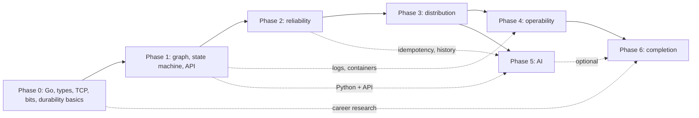

# Curriculum

Owner: learner approves; Claude proposes. `status` values: `PROPOSED` → `APPROVED`. Only the learner's explicit approval changes it, and the change is logged in `DECISION_LOG.md`. At approval, also record `approved_by`, `approved_on` and `catalog_fingerprint` (the output of `python3 tools/check_course.py --fingerprint`) in the header above; the checker then fails if the catalog's boundary columns change without an approved update. Revision 4 (see D-002, D-005). **Approved 2026-11-16** at commit `93e5a018d75b8c67036462e1a8a146a020ef5908` on `review/final-curriculum-candidate` (base `6e1b12ae18ce1af2458d2fcadaa9092472cd7903`), recorded in D-007. Approval authorizes the curriculum to begin. It does not mean its designs, estimates, acceptance criteria or career conclusions have been validated (see "Known risks carried forward").

## Study capacity (decided by the learner, D-002)

- **Planning commitment: 10 hours per week.** The essential curriculum is sized to this and nothing more.
- Weekends: up to 8 hours per day are possible. Weekdays: 2–4 hours are possible but optional. None of this extra time is counted as capacity.
- Extra hours are used, in order: (1) to finish the current unlock without borrowing from the reserve, (2) to absorb difficult challenges, (3) to take optional unlocks, in the order listed under "When ahead".

**Suggested weekly rhythm** (a default, not a rule): one longer weekend block (4–5 h) for building, one shorter block (3 h) for experiments and reading, one block (2 h) for verification and notes.

**Retention and transfer fit inside these hours.** Short no-notes recall at the start of a session, spaced revisits of earlier concepts, reuse of earlier concepts in later tasks, and occasional unfamiliar variations are part of each unlock's consolidate time. They add no hours and no separate workload. The maximum possible weekend time is not the expected weekly commitment: 10 hours a week is the baseline, and extra time is optional acceleration, depth or schedule recovery.

## Time budget

Window: 2026-11-30 (a Monday) to 2027-09-30 = 43.6 weeks = 436 gross hours at 10 h/week. This **assumes work starts on 2026-11-30**. If approval comes later, the start moves and the reserve shrinks hour for hour.

The Vietnamese Lunar New Year (Tet) is expected around 6 February 2027 (verify). One week of capacity (10 h) is removed for it. Net capacity ≈ 426 h.

**Essential plan: 362 hours.** Reserve ≈ 64 hours (about 18% of the essential plan). Of the reserve, about 26 h in Phase 6 is held for project hardening and career preparation. That leaves **about 38 h (10%)** for underestimated challenges, revision, integration problems and interruptions such as illness or a work crunch.

What this means plainly: if actual hours exceed my estimates by more than about 10% overall, the hardening and career time starts being eaten. If they exceed by more than about 18%, the plan fails without extra weekend hours or cuts. The three agreed cuts (below) would release up to 35 more hours for work not yet done. My estimates are judgment, not measurements, and are probably wrong by ±25% for individual unlocks. The plan therefore re-measures early (below).

### Hours by phase (run `python3 tools/check_course.py --budget` for current numbers)

| Phase | Essential unlocks | Essential h | build | study | verify | consolidate | Optional h |
|---|---|---|---|---|---|---|---|
| 0 Foundation | 14 | 86 | 45 | 19 | 15 | 7 | 43 |
| 1 Execution engine | 14 | 81 | 42 | 17 | 15 | 7 | 6 |
| 2 Reliability | 8 | 55 | 27 | 10 | 11 | 7 | 0 |
| 3 Distributed execution | 7 | 45 | 22 | 7 | 9 | 7 | 18 |
| 4 Operability | 9 | 45 | 24 | 8 | 11 | 2 | 11 |
| 5 Intelligent execution | 4 | 20 | 11 | 3 | 4 | 2 | 12 |
| 6 Completion | 5 | 30 | 16 | 4 | 5 | 5 | 4 |
| Stretch (PX) | — | — | — | — | — | — | 30 |
| **Total** | **61** | **362** | **187** | **68** | **70** | **37** | **124** |

Unlock-level estimates (with the same four-way split) are in `UNLOCKS/CATALOG.md`.

### Calendar

| Phase | Dates | Weeks | Capacity h | Essential h | Reserve h | Notes |
|---|---|---|---|---|---|---|
| 0 | 2026-11-30 → 2027-02-07 | 10 | 90 (Tet week removed) | 86 | 4 | Gate to Phase 1: `P0-GO-02`, `P0-GO-03`, `P0-TYPE-01`, `P0-NET-01`; remaining P0 work may overlap Phase 1 weekends |
| 1 | 2027-02-08 → 2027-04-11 | 9 | 90 | 81 | 9 | |
| 2 | 2027-04-12 → 2027-05-23 | 6 | 60 | 55 | 5 | Contains the step-effect unlock `P2-CONS-01`; thin reserve, draw on weekend extra hours first |
| 3 | 2027-05-24 → 2027-07-04 | 6 | 60 | 45 | 15 | Highest risk; largest phase reserve |
| 4 | 2027-07-05 → 2027-08-08 | 5 | 50 | 45 | 5 | Observability basics may start earlier |
| 5 | 2027-08-09 → 2027-08-22 | 2 | 20 | 20 | 0 | First to be cut |
| 6 | 2027-08-23 → 2027-09-30 | 5.6 | 56 | 30 | ~26 | Reserve held for hardening and career preparation |

Reserve is not spent by default; unused reserve rolls forward.

### How the essential plan was reached

The earlier proposal totalled about 440 hours by a rough count. I did not compress estimates to fit. I (1) estimated each unlock in four parts, (2) separated essential from optional by asking "does a completion criterion in `COURSE_OBJECTIVE.md` fail without it?", (3) re-estimated the remainder. Result: 357 hours of essential work and 124 hours of optional depth. The correction pass (D-005) raised essential work to 362 hours (table below). Changes and their effect on the final objective:

| Change | Hours | Effect on the objective |
|---|---|---|
| Hash table, search trees, heaps (`P0-DS-02/03/04`) optional | −19 | Interview-style data-structure depth is weaker. Retry timers use a stored "next attempt" time, so the engine does not need a heap. Revisit if `P0-CAR-01` shows data-structure screening in your target roles. |
| Memory model (`P0-MEM-01`) optional | −6 | Weaker explanation of Go allocation. No engine criterion depends on it. |
| Hand-written HTTP parser (`P0-NET-02`) optional | −7 | TCP stays (`P0-NET-01`); HTTP is learned from the standard library and wire captures inside `P1-API-01`. |
| Permission flags, packing, library packaging (`P0-BIT-03/04/07`) optional | −11 | Bit work keeps masks, varints and the framed parser, which the record log needs. |
| Linux operations (`P4-LNX-01`), Terraform (`P4-IAC-01`) optional | −11 | Weaker "operate infrastructure" signal; see career evidence. |
| Tool calling and approval gate (`P5-LLM-02`, `P5-AI-02`) optional | −12 | AI step keeps validation, timeout, retry, idempotency and cost cap; allow-lists and human approval become extensions. |
| Distributed-failure experiments, delivery write-up (`P3-DIST-01`, `P3-DLV-01`) optional | −10 | Phase 3 keeps fencing and chaos tests; the written reasoning is shorter. |
| Security review (`P6-SEC-01`) optional | −4 | Threat model (`P4-SEC-01`) stays. |
| Added: `P1-DEF-01`, `P1-RES-01` (workflow graph and step results) | +12 | Makes the chosen architecture explicit. |
| `P0-INT-01` (record log) kept essential, `P6-PERF-01` kept essential | — | Both give strong reliability/performance evidence. |
| Correction pass (D-005): `P2-CONS-01` widened to step-effect idempotency and delivery guarantees (was a 6 h write-up, now 9 h with the effect experiments) | +3 | Request idempotency alone does not stop a retried step repeating an external effect; both are now taught and demonstrated. |
| Correction pass (D-005): `P0-CAR-01` narrowed to an initial snapshot (at least 6 direct records per direction) and re-estimated from 5 h to 7 h | +2 | Honest effort for the scope; the decision between directions is not forced. |

### Checkpoints

Hours are re-measured and capability is checked at fixed points. Findings come from actual work products and recorded hours, not impressions. Each checkpoint is recorded in the Checkpoints table of `LEARNER_STATE.md`. Recommendations go to the learner. The essential scope, estimates and frozen boundaries change only through the approved change process (`CLAUDE.md` section 6).

Record actual hours for every completed unlock in `LEARNER_STATE.md`.

**Checkpoint 1: after 25 actual study hours.** Triggered by cumulative actual hours, whichever unlocks they fall in, not by a list of unlocks. Review:
1. Actual hours against estimates, per unlock and overall.
2. Whether the learner forms accurate mental models of new concepts, from the reconstruction and explanation results.
3. Whether the examples and visual representations are helping, and which kinds work.
4. How much guidance is needed before independent implementation (the guidance level recorded in each evaluation).
5. The time needed to produce and verify an evidence bundle.
6. Whether the workload is sustainable at 10 hours a week.

**End of every phase.** Evaluate demonstrated capability against that phase's existing exit criteria in `PHASES/PHASE-N.md`. Keep these apart in the record: work completed; understanding demonstrated; results independently reproduced (bundles marked `independently-reproduced`, as opposed to `preserved`); unresolved knowledge gaps; unverified assumptions. Mastery is never awarded for task completion alone.

**Critical checkpoint: before Phase 3.** This is the Phase 2 end-of-phase checkpoint with a stricter test. Phase 3 adds concurrency and distribution, so it does not start until this checkpoint is recorded as passed. Check, from the learner's own explanations and applications without notes, that the execution and reliability foundations hold:
- transaction boundaries and isolation (`P1-PG-03`, `P1-SM-02`);
- the state machine and its invariants (`P1-SM-01`);
- request idempotency, step-effect idempotency and the crash window (`P2-IDEM-01`, `P2-CONS-01`);
- retries, timeouts and recovery from saved state (`P2-RET-01`, `P2-TMO-01`, `P2-REC-01`) and failure injection (`P2-FAIL-01`);
- G1–G4 explained, with the crash points applied to a new variation.
If a foundation is weak, repair it first, starting from the earliest unresolved prerequisite, even if the schedule slips. Slippage is handled with the reserve, extra hours or a proposed cut, never by starting Phase 3 on weak foundations.

**Reading the hours.** Overall actual ÷ estimated: up to 1.10 is on track; 1.10 to 1.25 uses the reserve and the remaining plan is restated; above 1.25 triggers a curriculum review that may propose moving essential unlocks to optional, in the cut order below. Any unlock whose actual hours exceed its estimate by more than 25% is reported when it is completed.

### If behind: cut order (each is a proposal needing approval)

| Order | Cut | Hours saved | Effect on the completion criteria |
|---|---|---|---|
| 1 | All of Phase 5 (`P5-PY-01`, `P5-LLM-01`, `P5-AI-01`, `P5-INT-01`) | 20 | C6 is waived. Nothing else depends on Phase 5. |
| 2 | `P6-PERF-01` | 6 | No criterion depends on it; the load-test evidence is lost. |
| 3 | `P0-INT-01` | 9 | No criterion depends on it; the hands-on durability foundation is lost, PostgreSQL durability is still taught. |

Total 35 h. **Only C6 can be waived.** C1–C5, C7 and C8 stay reachable under every cut; `tools/check_course.py` verifies this from the `cut_order` line at the top of this file and the "Completion proofs" table in `COURSE_OBJECTIVE.md`: it fails if a cut would strand any essential unlock or remove anything a protected criterion needs.

**Why `P4-OBS-03` and `P4-K8S-01` are not in the cut order.** An earlier version listed both. That contradicted C5: `P4-OPS-01` (recovery drill and runbook) requires both, and `P4-INT-01` requires `P4-OPS-01`. The drill needs a deployed target (`P4-K8S-01`) and a way to see what failed across processes (`P4-OBS-03`); without them C5 would keep its name and lose its meaning. The complete operational path is therefore kept, and the cut capacity is smaller (35 h, not 47 h). If more than 35 h must be found, that is a scope change requiring a separate proposal, not another cut.

### When ahead: optional unlocks to take (default order, pending your answer to "career priority")

1. `P1-PG-04` Indexes and query plans (data-intensive signal)
2. `P3-DIST-01` Clocks and partial failure
3. `P3-MSG-01` Message broker comparison (Kafka appears often in Go backend postings)
4. `P4-IAC-01` Terraform basics; `P4-LNX-01` Linux operations
5. `P5-LLM-02` Tool calling
6. `P0-DS-02/03/04`, `P0-MEM-01`, `P0-NET-02`, remaining optional items
7. Stretch: `PX-UI-01`, `PX-REPLAY-01`. (Rust is a separate leisure track, not part of this list: `knowledge/languages/rust/README.md`.)

## Known risks carried forward

Approval does not retire these. They stay visible until the evidence says otherwise.

| # | Risk | What is done about it |
|---|---|---|
| R1 | The unprotected reserve is about 38 h (10%), and only 5 h in Phase 2. | Watch the hours ratio at every checkpoint. Do not assume overruns recover by themselves; use extra hours, the reserve, or a proposed cut. |
| R2 | The 9 h estimate for `P2-CONS-01` may be optimistic. Its acceptance criterion 4 implies several crash-point cases. | Measure the actual hours. Report any variance above 25% when the unlock is completed. A change to the estimate is a proposal that needs approval. |
| R3 | The career research is incomplete. The 42 search-result pointers are not 42 reviewed postings, and none has been read. | Read actual postings in `P0-CAR-01` before drawing strong conclusions. Do not force a specialization decision before the evidence supports one. |
| R4 | The platform's architecture and acceptance criteria are hypotheses until implemented and tested. | State results as observed, not assumed. Unexecuted criteria are never reported as passed. |
| R5 | No evidence bundle has been independently reproduced. | A bundle is called `independently-reproduced` only after its commands have been rerun in a clean environment and the results verified. |

## Workflow execution model (decided, D-002)

Declarative workflow graphs with persisted step results. Each step has a stable identity, a state, a declared input and output contract, and a saved result where appropriate. Inspection, retries and recovery work from saved state, not by re-running code. Deterministic replay is an optional advanced experiment (`PX-REPLAY-01`) as an **isolated project area** (`PRJ-REPLAY-LAB`). It must not change the essential project, its schema or its completion criteria.

## Phase summary

Per-phase purpose, capabilities, deliverables and exit criteria: `PHASES/PHASE-N.md`.

| Phase | Name | Deliverable |
|---|---|---|
| 0 | Foundation | Go fluency, parsers, record log, role map |
| 1 | Execution engine | Engine v0.1: graph definitions, state machine, API, SDK |
| 2 | Reliability | Survives `kill -9`, idempotent, retries, history |
| 3 | Distributed execution | Multiple workers with leases and fencing |
| 4 | Operability | Deployed, observable platform with runbooks |
| 5 | Intelligent execution | AI step with controls |
| 6 | Completion | Reviewed, documented, demonstrable project and career package |

## Dependency structure

The unlock-level graph is in `UNLOCKS/CATALOG.md`; print it with `python3 tools/check_course.py --mermaid`. The checker enforces: no cycles, no prerequisite from a later phase, and no essential unlock that requires an optional one.

## What can run in parallel (allowed by the graph)

| Pair | Why it is independent |
|---|---|
| `P0-CAR-01` with everything in Phase 0 | Research uses no code |
| `P0-BIT-*` with `P0-GO-02/03`, `P0-TYPE-01`, `P0-NET-01` | Different skills; both need only Go basics |
| `P0-OS-01/02`, `P0-INT-01` with early Phase 1 | Durability work does not block the database work |
| `P1-PG-*` with `P1-DEF-01` | Storage and model design meet at `P1-SM-02` |
| `P1-SDK-01` with `P1-TEST-01` | Both only need the API |
| `P4-OBS-01/02`, `P4-DOC-01`, `P4-CI-01` with Phases 2–3 | Need only the Phase 1 engine; good weekday-sized work |
| `P5-PY-01` with Phases 2–4 | Needs only the API |

## Status vocabulary

- **Completed:** in `LEARNER_STATE.md` with evidence and enough mastery.
- **Available:** not completed, every prerequisite completed.
- **Blocked:** a prerequisite is not completed; the checker names it.
- Nothing is available while `status` is `PROPOSED`.

## Mastery targets

Scale in `KNOWLEDGE_STANDARD.md` section 8. L5 is reserved for decisions the platform rests on: workflow model and state machine, atomic transitions, idempotency, delivery semantics, leases and fencing, failure handling, AI boundaries.
