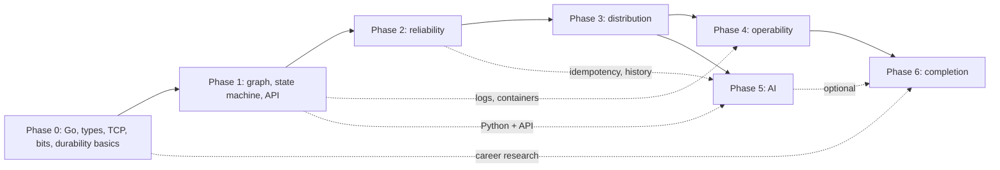

# Curriculum

Owner: learner approves; Claude proposes. `status` values: `PROPOSED` → `APPROVED`. Only the learner's explicit approval changes it, and the change is logged in `DECISION_LOG.md`. Revision 2 (see D-002). Not approved; nothing may be taught.

## Study capacity (decided by the learner, D-002)

- **Planning commitment: 10 hours per week.** The essential curriculum is sized to this and nothing more.
- Weekends: up to 8 hours per day are possible. Weekdays: 2–4 hours are possible but optional. None of this extra time is counted as capacity.
- Extra hours are used, in order: (1) to finish the current unlock without borrowing from the reserve, (2) to absorb difficult challenges, (3) to take optional unlocks, in the order listed under "When ahead".

**Suggested weekly rhythm** (a default, not a rule): one longer weekend block (4–5 h) for building, one shorter block (3 h) for experiments and reading, one block (2 h) for verification and notes.

## Time budget

Window: 2026-11-30 (a Monday) to 2027-09-30 = 43.6 weeks = 436 gross hours at 10 h/week. This **assumes work starts on 2026-11-30**. If approval comes later, the start moves and the reserve shrinks hour for hour.

The Vietnamese Lunar New Year (Tet) is expected around 6 February 2027 (verify). One week of capacity (10 h) is removed for it. Net capacity ≈ 426 h.

**Essential plan: 357 hours.** Reserve ≈ 69 hours (about 19% of the essential plan). Of the reserve, about 26 h in Phase 6 is held for project hardening and career preparation. That leaves **about 43 h (12%)** for underestimated challenges, revision, integration problems and interruptions such as illness or a work crunch.

What this means plainly: if actual hours exceed my estimates by more than about 12% overall, the hardening and career time starts being eaten. If they exceed by more than about 19%, the plan fails without extra weekend hours or cuts. My estimates are judgment, not measurements, and are probably wrong by ±25% for individual unlocks. The plan therefore re-measures early (below).

### Hours by phase (run `python3 tools/check_course.py --budget` for current numbers)

| Phase | Essential unlocks | Essential h | build | study | verify | consolidate | Optional h |
|---|---|---|---|---|---|---|---|
| 0 Foundation | 14 | 84 | 45 | 17 | 15 | 7 | 43 |
| 1 Execution engine | 14 | 81 | 42 | 17 | 15 | 7 | 6 |
| 2 Reliability | 8 | 52 | 25 | 10 | 11 | 6 | 0 |
| 3 Distributed execution | 7 | 45 | 22 | 7 | 9 | 7 | 18 |
| 4 Operability | 9 | 45 | 24 | 8 | 11 | 2 | 11 |
| 5 Intelligent execution | 4 | 20 | 11 | 3 | 4 | 2 | 12 |
| 6 Completion | 5 | 30 | 16 | 4 | 5 | 5 | 4 |
| Stretch (PX) | — | — | — | — | — | — | 30 |
| **Total** | **61** | **357** | **185** | **66** | **70** | **36** | **124** |

Unlock-level estimates (with the same four-way split) are in `UNLOCKS/CATALOG.md`.

### Calendar

| Phase | Dates | Weeks | Capacity h | Essential h | Reserve h | Notes |
|---|---|---|---|---|---|---|
| 0 | 2026-11-30 → 2027-02-07 | 10 | 90 (Tet week removed) | 84 | 6 | Gate to Phase 1: `P0-GO-02`, `P0-GO-03`, `P0-TYPE-01`, `P0-NET-01`; remaining P0 work may overlap Phase 1 weekends |
| 1 | 2027-02-08 → 2027-04-11 | 9 | 90 | 81 | 9 | |
| 2 | 2027-04-12 → 2027-05-23 | 6 | 60 | 52 | 8 | |
| 3 | 2027-05-24 → 2027-07-04 | 6 | 60 | 45 | 15 | Highest risk; largest phase reserve |
| 4 | 2027-07-05 → 2027-08-08 | 5 | 50 | 45 | 5 | Observability basics may start earlier |
| 5 | 2027-08-09 → 2027-08-22 | 2 | 20 | 20 | 0 | First to be cut |
| 6 | 2027-08-23 → 2027-09-30 | 5.6 | 56 | 30 | ~26 | Reserve held for hardening and career preparation |

Reserve is not spent by default; unused reserve rolls forward.

### How the essential plan was reached

The earlier proposal totalled about 440 hours by a rough count. I did not compress estimates to fit. I (1) estimated each unlock in four parts, (2) separated essential from optional by asking "does a completion criterion in `COURSE_OBJECTIVE.md` fail without it?", (3) re-estimated the remainder. Result: 357 hours of essential work and 124 hours of optional depth. Changes and their effect on the final objective:

| Change | Hours | Effect on the objective |
|---|---|---|
| Hash table, search trees, heaps (`P0-DS-02/03/04`) optional | −19 | Interview-style data-structure depth is weaker. Retry timers use a stored "next attempt" time, so the engine does not need a heap. Revisit if `P0-CAR-01` shows data-structure screening in your target roles. |
| Memory model (`P0-MEM-01`) optional | −6 | Weaker explanation of Go allocation. No engine criterion depends on it. |
| Hand-written HTTP parser (`P0-NET-02`) optional | −7 | TCP stays (`P0-NET-01`); HTTP is learned from the standard library and wire captures inside `P1-API-01`. |
| Permission flags, packing, library packaging (`P0-BIT-03/04/07`) optional | −11 | Bit work keeps masks, varints and the framed parser, which the record log needs. |
| Linux operations (`P4-LNX-01`), Terraform (`P4-IAC-01`) optional | −11 | Weaker "operate infrastructure" signal; see career evidence. |
| Tool calling and approval gate (`P5-LLM-02`, `P5-AI-02`) optional | −12 | AI step keeps validation, timeout, retry, idempotency and cost cap; allow-lists and human approval become extensions. |
| Distributed-failure experiments, delivery write-up (`P3-DIST-01`, `P3-DLV-01`) optional | −10 | Phase 3 keeps fencing and chaos tests; the written reasoning is shorter. |
| Security review (`P6-SEC-01`) optional | −4 | Threat model (`P4-SEC-01`) stays. |
| Added: `P1-DEF-01`, `P1-RES-01` (workflow graph and step results) | +12 | Makes the chosen architecture explicit. |
| `P0-INT-01` (record log) kept essential, `P6-PERF-01` kept essential | — | Both give strong reliability/performance evidence. |

### Re-measuring (recalibration)

Record actual hours for every completed unlock in `LEARNER_STATE.md`.
- **Checkpoint 1:** after the first 25 estimated hours (`P0-CAR-01`, `P0-GO-01`, `P0-GO-02`, `P0-GO-03`). Compute actual ÷ estimated.
- **Checkpoint 2:** end of each phase.
- ≤ 1.10: on track. 1.10–1.25: use reserve, restate the remaining plan. > 1.25: curriculum review: propose moving essential unlocks to optional, in the cut order below.

### If behind: cut order (each is a proposal needing approval)

| Order | Cut | Hours saved | Effect |
|---|---|---|---|
| 1 | All of Phase 5 | 20 | Lose C6 (AI step). Core platform unaffected. |
| 2 | `P6-PERF-01` | 6 | No load-test evidence. |
| 3 | `P0-INT-01` | 9 | Less hands-on durability foundation; Postgres-based durability still taught. |
| 4 | `P4-OBS-03` | 5 | Logs and metrics stay; tracing C4 part dropped. |
| 5 | `P4-K8S-01` | 7 | Deploy with containers on one host; weaker platform signal. |

C1, C2, C3 and C5 are never cut. They define a reliable engine.

### When ahead: optional unlocks to take (default order, pending your answer to "career priority")

1. `P1-PG-04` Indexes and query plans (data-intensive signal)
2. `P3-DIST-01` Clocks and partial failure
3. `P3-MSG-01` Message broker comparison (Kafka appears often in Go backend postings)
4. `P4-IAC-01` Terraform basics; `P4-LNX-01` Linux operations
5. `P5-LLM-02` Tool calling
6. `P0-DS-02/03/04`, `P0-MEM-01`, `P0-NET-02`, remaining optional items
7. Stretch: `PX-UI-01`, `PX-RUST-01`, `PX-REPLAY-01`

## Workflow execution model (decided, D-002)

Declarative workflow graphs with persisted step results. Each step has a stable identity, a state, a declared input and output contract, and a saved result where appropriate. Inspection, retries and recovery work from saved state, not by re-running code. Deterministic replay is an optional advanced experiment (`PX-REPLAY-01`) as an **isolated project area** (`PRJ-REPLAY-LAB`). It must not change the essential project, its schema or its completion criteria.

## Phase summary

Per-phase purpose, capabilities, deliverables and exit criteria: `PHASES/PHASE-N.md`.

| Phase | Name | Deliverable |
|---|---|---|
| 0 | Foundation | Go fluency, parsers, record log, role map |
| 1 | Execution engine | Engine v0.1: graph definitions, state machine, API, SDK |
| 2 | Reliability | Survives `kill -9`, idempotent, retries, history |
| 3 | Distributed execution | Multiple workers with leases and fencing |
| 4 | Operability | Deployed, observable platform with runbooks |
| 5 | Intelligent execution | AI step with controls |
| 6 | Completion | Reviewed, documented, demonstrable project and career package |

## Dependency structure

The unlock-level graph is in `UNLOCKS/CATALOG.md`; print it with `python3 tools/check_course.py --mermaid`. The checker enforces: no cycles, no prerequisite from a later phase, and no essential unlock that requires an optional one.

## What can run in parallel (allowed by the graph)

| Pair | Why it is independent |
|---|---|
| `P0-CAR-01` with everything in Phase 0 | Research uses no code |
| `P0-BIT-*` with `P0-GO-02/03`, `P0-TYPE-01`, `P0-NET-01` | Different skills; both need only Go basics |
| `P0-OS-01/02`, `P0-INT-01` with early Phase 1 | Durability work does not block the database work |
| `P1-PG-*` with `P1-DEF-01` | Storage and model design meet at `P1-SM-02` |
| `P1-SDK-01` with `P1-TEST-01` | Both only need the API |
| `P4-OBS-01/02`, `P4-DOC-01`, `P4-CI-01` with Phases 2–3 | Need only the Phase 1 engine; good weekday-sized work |
| `P5-PY-01` with Phases 2–4 | Needs only the API |

## Status vocabulary

- **Completed:** in `LEARNER_STATE.md` with evidence and enough mastery.
- **Available:** not completed, every prerequisite completed.
- **Blocked:** a prerequisite is not completed; the checker names it.
- Nothing is available while `status` is `PROPOSED`.

## Mastery targets

Scale in `KNOWLEDGE_STANDARD.md` section 8. L5 is reserved for decisions the platform rests on: workflow model and state machine, atomic transitions, idempotency, delivery semantics, leases and fencing, failure handling, AI boundaries.
